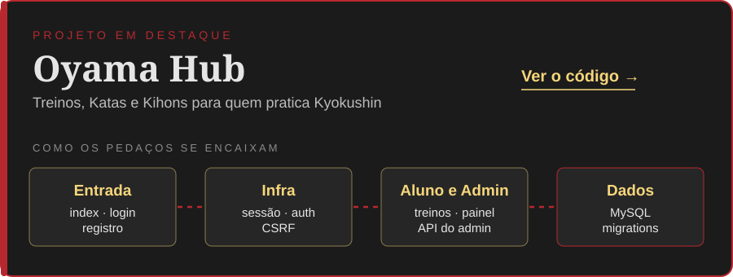
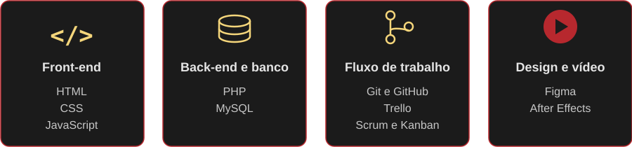

 

<a href="#sobre-mim">Sobre mim</a> &nbsp;·&nbsp;
<a href="#projetos">Projetos</a> &nbsp;·&nbsp;
<a href="#tecnologias">Tecnologias</a> &nbsp;·&nbsp;
<a href="#contato">Contato</a>

## Oi, eu sou o João Pedro 👋

Sou de Jacareí (SP), estudante de Desenvolvimento de Sistemas no SESI/SENAI e futuro desenvolvedor web. Gosto de programar, desenhar interfaces e encontrar maneiras de transformar uma ideia em algo que realmente funcione.

Meu interesse por programação vai além de escrever código. Curto entender como as partes de uma aplicação se conectam, desde a estrutura do banco de dados e a lógica do back-end até os detalhes da interface. Também gosto de design, edição de vídeo e cultura oriental — especialmente tudo que envolve o Japão e o karatê Kyokushin.

Estou buscando minha primeira oportunidade como desenvolvedor web júnior, onde possa contribuir com o que já aprendi e ganhar experiência trabalhando em projetos reais.

## Projetos

### 🥋 Oyama Hub

O Oyama Hub é um projeto desenvolvido em grupo durante o curso técnico. A ideia é reunir, em um só lugar, recursos úteis para quem pratica Kyokushin: registro de treinos, acompanhamento da evolução e acesso a conteúdos sobre Katas e Kihons. O nome homenageia Masutatsu Oyama, fundador do estilo.

Foi uma oportunidade de trabalhar com diferentes partes de uma aplicação web e entender melhor como elas se integram.

**Tecnologias:** PHP, MySQL, HTML, CSS e JavaScript.

Entre os recursos e componentes do projeto estão:

- Autenticação, cadastro e recuperação de senha por token.
- Área do aluno para registrar treinos.
- Painel administrativo separado e API própria.
- Proteção contra CSRF no painel administrativo e na API correspondente.
- Estrutura de banco de dados com schema e migrations.
- Smoke tests para verificar sintaxe, arquivos críticos e possíveis credenciais expostas.

Se quiser conhecer melhor a organização do código, vale conferir a [documentação de arquitetura](https://github.com/joaothearthefato/Oyama-Hub/blob/main/docs/architecture.md).

<b>Como o projeto está organizado</b>

| Diretório | Responsabilidade |
|---|---|
| `php/` | Entrada pública, autenticação, infraestrutura e administração |
| `dashboard/` | Área do aluno e handlers |
| `includes/` | Componentes PHP compartilhados |
| `css/`, `js/`, `img/` | Recursos da interface |
| `database/` | Schema e migrations |
| `uploads/` | Arquivos enviados pelos usuários |
| `tests/` | Testes automatizados de verificação |
| `docs/` | Arquitetura, deploy e auditoria |
| `legacy/` | Arquivos antigos mantidos para consulta |

### 🎲 ROMUS

Também estou desenvolvendo o [ROMUS](https://github.com/joaothearthefato/Romus), um projeto voltado para RPG, criado para um amigo. É outra oportunidade de explorar ideias próprias, pensar na organização de funcionalidades e continuar praticando desenvolvimento.

## Tecnologias e aprendizado

No dia a dia dos projetos, trabalho principalmente com **HTML, CSS, JavaScript, PHP e MySQL**. Também utilizo Git e GitHub para versionamento, e Trello para organizar tarefas com práticas de Scrum e Kanban.

Tenho interesse em unir desenvolvimento e design, por isso também utilizo Figma e After Effects.

Atualmente, estou aprofundando meus conhecimentos em segurança de aplicações web, incluindo validação de entradas, XSS, SQL Injection e CSRF. Também venho estudando acessibilidade, boas práticas de UX e deploy de aplicações PHP/MySQL.

Minha formação técnica começou em janeiro de 2025 e tem conclusão prevista para dezembro de 2026. É nesse período que venho construindo a base que quero levar para minha carreira profissional.

<b>Um pouco mais sobre mim</b>

- **Localização:** Jacareí, São Paulo, Brasil.
- **Formação:** Técnico em Desenvolvimento de Sistemas — SESI/SENAI.
- **Idiomas:** português nativo e inglês intermediário/avançado.
- **Interesses:** desenvolvimento web, design, edição de vídeo, cultura oriental e Kyokushin.

## Vamos conversar?

Estou aberto a oportunidades júnior, feedbacks sobre meus projetos e conversas com pessoas que também curtem tecnologia e design.

 

押忍 — Osu. 🥋

